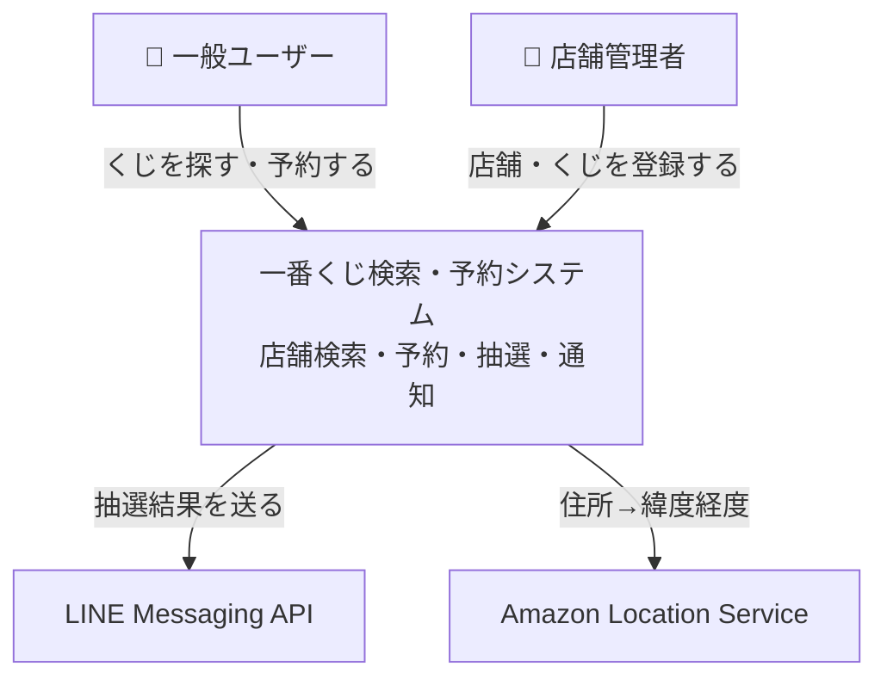

# 一番くじ検索・予約アプリ

近くの店舗の一番くじの販売状況を地図で探し、ウォッチ・予約・入荷通知を使えるアプリです。AWS のサーバーレス構成で、インフラは AWS CDK、コードは TypeScript（npm workspaces）で管理しています。

## アーキテクチャ概要

利用者は、くじを探して予約する一般ユーザーと、店舗やくじの在庫を登録する店舗管理者の2種類です。システムは LINE（通知）と Amazon Location Service（住所検索）に接続しています。



コンテナ構成、バックエンドのコンポーネント、データモデルは [docs/architecture.md](./docs/architecture.md) を参照してください。

## ディレクトリ構成

| パス | 内容 |
|---|---|
| `packages/frontend` | Next.js 16 / React 19 / Tailwind 4。静的エクスポートして S3 + CloudFront で配信 |
| `packages/backend` | Lambda ハンドラーとサービス。開発用シードスクリプトを含む |
| `packages/shared` | フロントとバックエンドで共有する型と定数 |
| `infra` | AWS CDK のスタック定義 |
| `docs` | [アーキテクチャ](./docs/architecture.md)、[シーケンス図](./docs/sequence-diagrams.md)、[画面遷移図](./docs/screen-transition.md) |

## 開発用コマンド

```bash
npm install
npm run build
npm run seed:dev
```

`seed:dev` の詳細は [packages/backend/src/seed_scripts/README.md](./packages/backend/src/seed_scripts/README.md) を参照してください。
