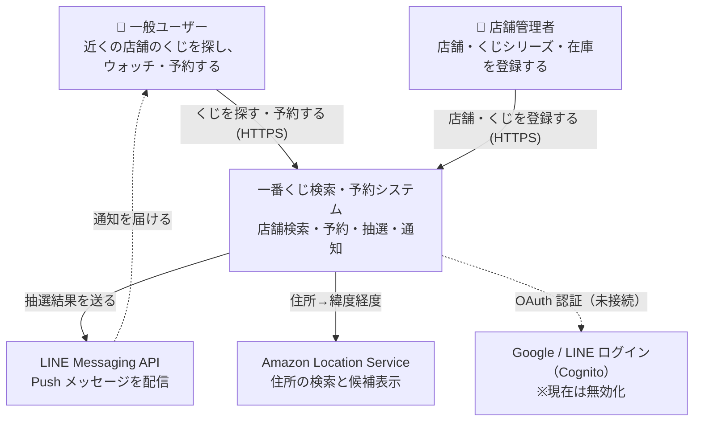
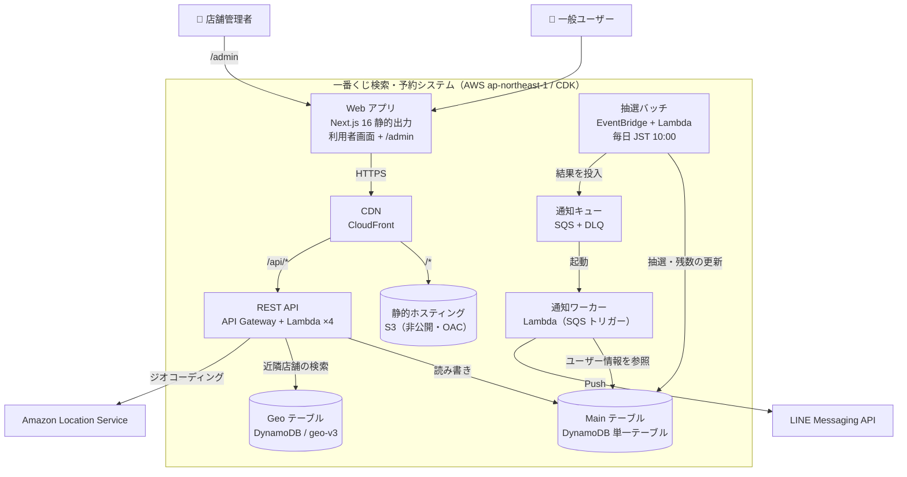
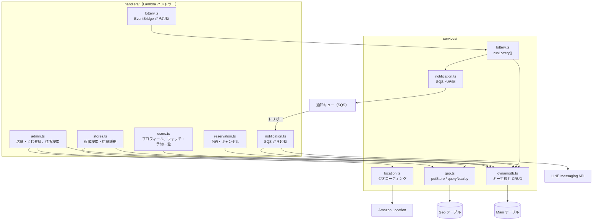

# アーキテクチャ（C4 モデル）

一番くじの店舗検索・予約アプリの構成を、C4 モデルの Level 1〜3 で示します。Level 4（コード）は、データモデルとして Main テーブルのキー設計だけを載せています。

基準コミット: `d047380`（main）。インフラの正は `infra/lib/stacks/`、コードの正は `packages/` です。

## Level 1: システムコンテキスト

## Level 2: コンテナ

| コンテナ | 技術 | 役割 | 定義場所 |
|---|---|---|---|
| Web アプリ | Next.js 16 / React 19 / Tailwind 4 / Leaflet | 店舗地図、くじ一覧、ウォッチリスト、予約、マイページ、管理画面。`output: 'export'` で静的出力 | `packages/frontend` |
| CDN | CloudFront + CloudFront Function | `/*` は S3、`/api/*` は API Gateway へ振り分け。`/path` を `/path/index.html` に書き換え | `infra/lib/stacks/frontend-stack.ts` |
| REST API | API Gateway + Lambda ×4（Node.js 20） | `/api/v1` 配下。Users / Stores / Reservation / Admin | `infra/lib/stacks/api-stack.ts` |
| 抽選バッチ | EventBridge（cron UTC 01:00）+ Lambda | 予約者の抽選、残数の更新、結果を通知キューへ投入 | `infra/lib/stacks/scheduler-stack.ts` |
| 通知キュー / ワーカー | SQS + DLQ（3回失敗で退避）/ Lambda | 通知を非同期に処理し、LINE Push を送信 | `infra/lib/stacks/notification-stack.ts` |
| Main テーブル | DynamoDB（GSI1〜3） | ユーザー、店舗、くじ、予約、ウォッチリスト、抽選結果 | `infra/lib/stacks/database-stack.ts` |
| Geo テーブル | DynamoDB + dynamodb-geo-v3 | 店舗の緯度経度をジオハッシュで保存し、半径検索に使う | `infra/lib/stacks/database-stack.ts` |

## Level 3: コンポーネント（バックエンド）

`packages/backend/src` の構成です。Lambda ハンドラーが HTTP やイベントを受け、サービスモジュールが AWS SDK を包んでいます。型と定数は `packages/shared` にあり、フロントとバックエンドの両方が使います。

| ハンドラー | エンドポイント / 処理 |
|---|---|
| `users.ts` | `GET /users/me`、ウォッチリストの `GET / POST / DELETE`、`GET /users/me/reservations` |
| `stores.ts` | `GET /stores/nearby?lat&lng&radius`、`GET /stores/{storeId}` |
| `reservation.ts` | `POST / DELETE /stores/{storeId}/kuji/{seriesId}/reserve` |
| `admin.ts` | 店舗とくじの登録・更新、予約者一覧、`POST /admin/geocode`、`GET /admin/suggest` |
| `lottery.ts` | 毎日 JST 10:00 に `runLottery()` を実行 |
| `notification.ts` | `watchlist_match` / `lottery_result` メッセージを処理し、LINE Push を送信 |

## Level 4: データモデル（Main テーブルのキー設計）

PK / SK と3つの GSI を持つシングルテーブル設計です。キーは `services/dynamodb.ts` の `keys` で生成します。

| エンティティ | PK | SK | GSI（用途） |
|---|---|---|---|
| ユーザー | `USER#{userId}` | `PROFILE` | なし |
| ウォッチリスト | `USER#{userId}` | `WATCH#{seriesId}` | GSI1 `SERIES#{seriesId}` / `WATCH#{userId}`：シリーズをウォッチしている人の一覧 |
| 店舗 | `STORE#{storeId}` | `PROFILE` | なし（位置は Geo テーブル） |
| くじシリーズ | `STORE#{storeId}` | `KUJI#{seriesId}` | GSI2 `SERIES#{seriesId}` / `STORE#{storeId}`：シリーズを扱う店舗の一覧 |
| 予約 | `STORE#{storeId}#KUJI#{seriesId}` | `RESERVATION#{userId}` | GSI3 `USER#{userId}` / `RESERVATION#{storeId}#{seriesId}`：自分の予約一覧 |
| 抽選結果 | `STORE#{storeId}#KUJI#{seriesId}` | `LOTTERY#{date}#{userId}` | なし |

## 現状の注意点

- **認証が無効**: Cognito（Google / LINE ログイン）の `AuthStack` は `infra/bin/app.ts` でコメントアウトされています。API は全エンドポイントが認証なしの公開状態で、開発用に `x-dev-user-id` ヘッダーで利用者を切り替えています。
- **Web Push は未実装**: 通知ワーカーで実際に送れるのは LINE Push だけです。
- **API の SQS 権限が未使用**: API の Lambda には通知キューへの送信権限がありますが、今のコードで通知を送っているのは抽選処理だけです。`watchlist_match` を送る処理は見当たりません。
- **フロントにモックが残っている**: `mockData.ts` と `mockNotifications.ts` があり、一部の画面は API ではなくモックデータで表示しています。`app/api.disabled/` は静的出力への切り替えで無効になっています。

## 関連ドキュメント

- [シーケンス図](./sequence-diagrams.md)
- [画面遷移図](./screen-transition.md)
